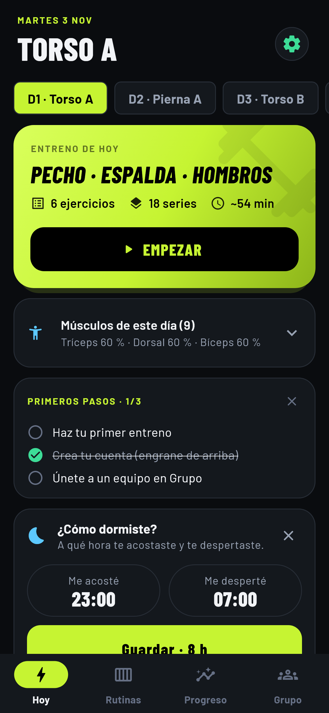
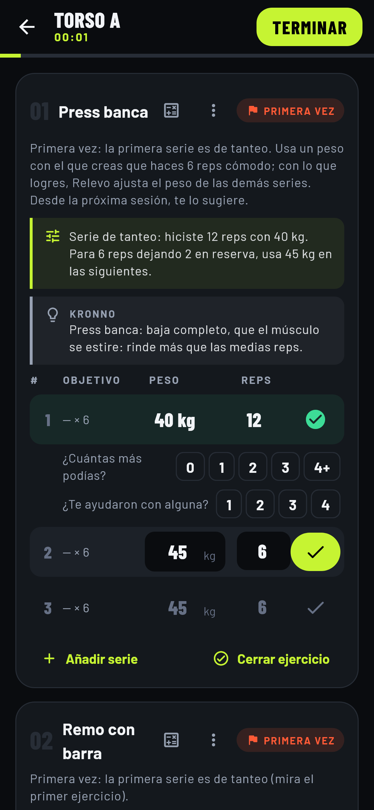
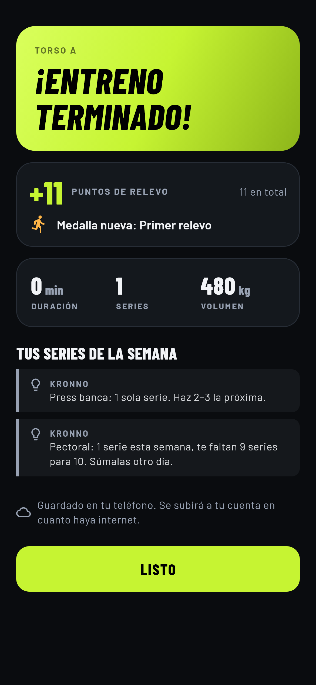
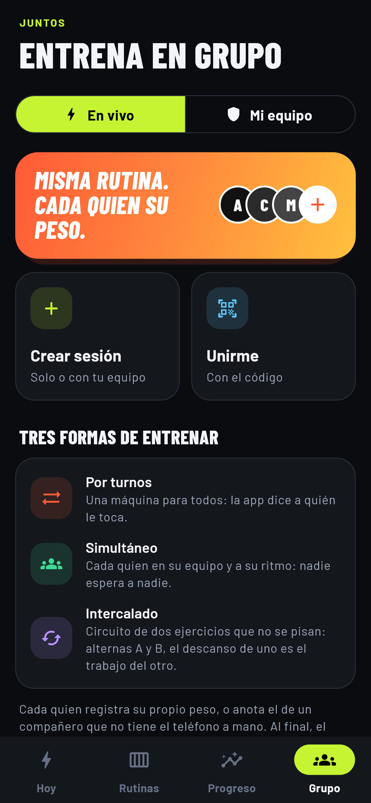
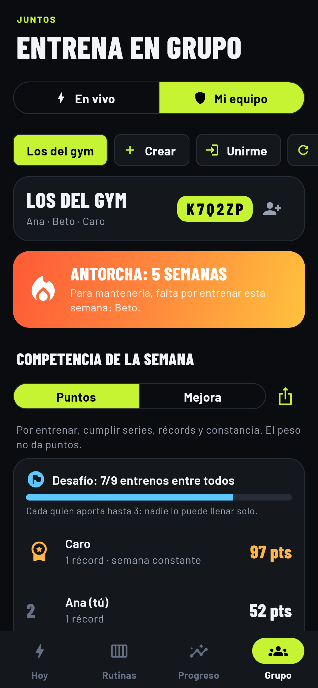
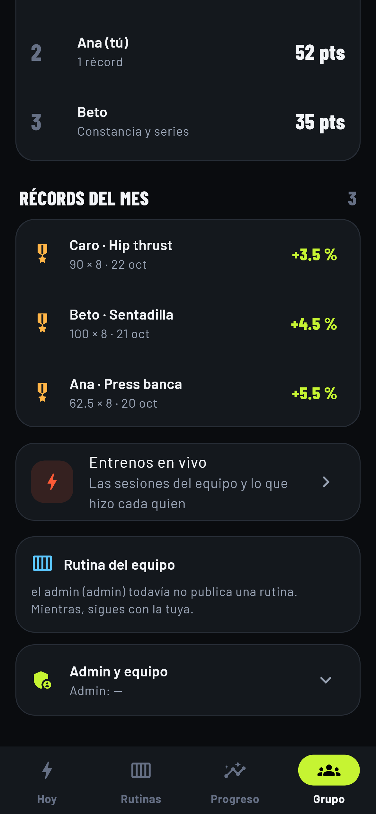
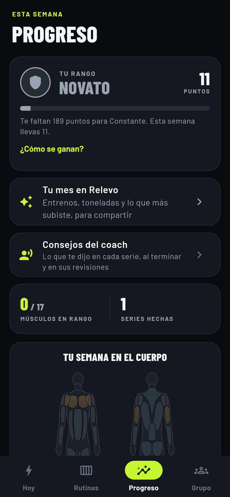
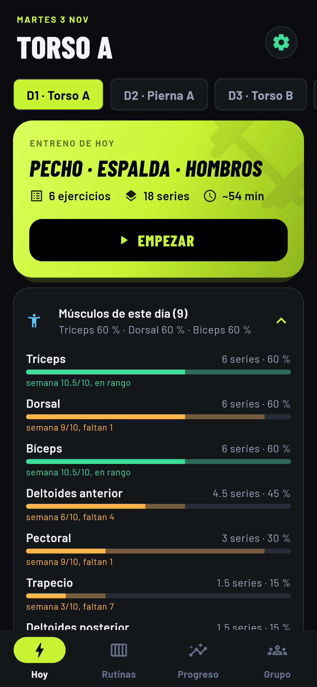
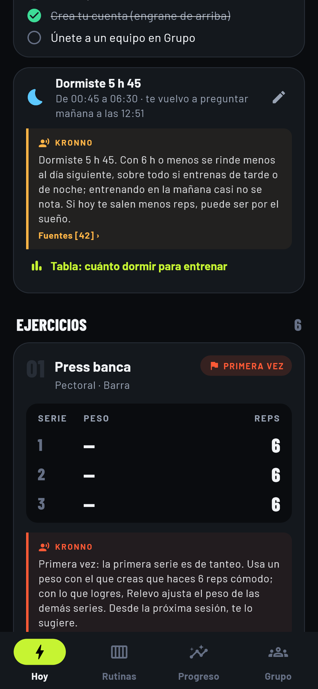

<p align="center">
  
</p>

<h1 align="center">Relevo</h1>

<p align="center">
  App de entrenamiento de fuerza para grupos de amigos:<br/>
  cada quien con su peso, todos compitiendo contra sí mismos.
</p>

<p align="center">
  <a href="https://relevo.webtrader.trade/">🔗 Presentación del proyecto</a> ·
  <a href="https://webtrader.trade/relevo/">🌐 Página de la app</a>
</p>

> 🔒 **El código fuente de este proyecto es privado.** Este repositorio es una vista general (funciones, arquitectura y capturas) para portafolio. El código está disponible bajo solicitud en una entrevista.

---

## Capturas reales

<p align="center">
  
  
  <br/>
  
  
  <br/>
  
  
  
</p>

<sub>Las capturas salen de la app real, generadas automáticamente en un test de Flutter (golden tests).</sub>

## Qué hace

**Para entrenar en grupo**

- **Entreno en vivo en el mismo gimnasio:** una persona crea la sesión y los demás entran con un código. La app lleva los turnos en la máquina, el descanso común o un **circuito intercalado** (el descanso de uno es el trabajo del otro).
- **Competencia justa:** cada quien se compara consigo mismo. Los **Puntos de Relevo** premian entrenar, cumplir series, romper récords y ser constante; el peso no da puntos.
- **La antorcha:** una racha de todo el equipo que se mantiene encendida mientras cada quien entrene en la semana.
- **Liga semanal, récords y medallas**, con avisos que traen de vuelta al grupo.

**Para cada persona**

- **Motor de progresión** con 6 modelos (lineal, doble, ondulante, por bloques, triple y densidad) que calcula la próxima sesión y explica cada decisión en lenguaje normal.
- **Coach con recomendaciones basadas en estudios**, cada una con sus fuentes.
- **Primer día sin adivinar:** la primera serie es de tanteo y con ella se calcula el peso del resto.
- **Dictado por voz** de las series ("20 kilos 12 repeticiones").
- **Mapa muscular**, volumen semanal por músculo y registro del sueño.
- **Funciona sin internet:** todo se guarda en el teléfono y se sincroniza cuando hay conexión.
- Tema oscuro y claro, widget de Android y notificaciones.

## Arquitectura

```
 App Flutter (Android / iOS)                Backend
 ┌──────────────────────────┐               ┌──────────────────────────────┐
 │ Pantallas                │               │ Node.js + TypeScript         │
 │ Motor de progresión      │  REST + JWT   │ Express (cuentas, sync)      │
 │ (Dart puro, sin red)     │◄─────────────►│ Socket.IO (sesiones en vivo) │
 │ SQLite + cola de sync    │  Socket.IO    │ PostgreSQL                   │
 └──────────────────────────┘               └──────────────────────────────┘
```

- **Offline-first:** cada cambio se guarda en SQLite y deja una operación en una cola de salida, en la misma transacción. Un cambio solo sale de la cola cuando el servidor lo confirma.
- **Sincronización incremental:** subida de cambios y bajada por versión (`desde=N`). En los conflictos gana el cambio más reciente, y los borrados son lógicos para que también viajen.
- **Sesiones en vivo en tiempo real** con Socket.IO. Si se pierde la conexión, las series quedan en cola y se envían en orden al reconectar.
- **Motor de progresión aislado** en Dart puro, cubierto con pruebas unitarias.
- **Pruebas:** el backend se prueba contra un PostgreSQL temporal y la app con SQLite en memoria.

## Stack

| Capa | Tecnologías |
|---|---|
| App | Flutter, Dart, sqflite (SQLite), socket_io_client, workmanager, flutter_local_notifications, speech_to_text, fl_chart |
| Backend | Node.js, TypeScript, Express, Socket.IO, JWT |
| Base de datos | PostgreSQL |
| Pruebas | flutter_test (unitarias, de widgets y golden), pruebas de integración del backend |

---

Desarrollado por **Airan Bracamonte** · [LinkedIn](https://www.linkedin.com/in/airan-bracamonte) · [Portafolio](https://airanbracamonte.vercel.app)
